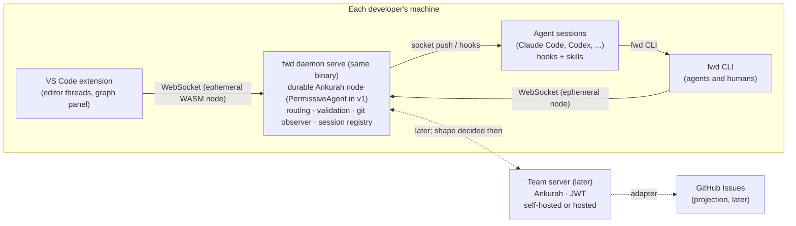

# fwdcentaur design: overview and architecture

Draft for discussion, 2026-09-24. Status vocabulary, borrowed from Manifold: **R** is a requirement Daniel stated; **P** is a proposal in this packet; **F** is a finding backed by `../research/`; **U** is unresolved. Everything in this directory is P unless marked otherwise. `../DECISIONS.md` is the ledger.

## The shape

Five components, three of which ship in the first slice (the CLI and the daemon are one binary):

1. **`fwd-core`** (Rust library): the Ankurah models, the rules (readiness, cycles, claims, rights) as client-side pre-checks and daemon-side validation (later a `PolicyAgent` referee), inbox routing, anchor resolution. Everything with semantics lives here so clients, the daemon, the server and tests share one implementation.
2. **The daemon**, `fwd daemon serve`: the same `fwd` binary re-executed by the first client (a hidden subcommand), hosting the project's durable Ankurah node and running the routing, validation, git-observer and session-registry services, serving every client over Ankurah's WebSocket connector; see `daemon.md`.
3. **`fwd`** (Rust CLI): an ephemeral Ankurah node with in-memory storage; the interface agents use, whose commands the daemon's MCP endpoint also serves as tools (`mcp.md`); JSON on non-TTY; stable exit codes; see `cli.md`.
4. **VS Code extension** (TypeScript): comment threads in editor and diff views, gutter decorations for anchors, the graph panel, the scope view; see `vscode-extension.md`.
5. **Team server** (later): `fwd daemon serve` in server mode with Ankurah's JWT RBAC; the same binary. Whether it is the project's durable node or a durable peer of each daemon is decided when hosting is designed.

## Principles

- **Ankurah-native.** Every client is an ephemeral Ankurah node; the daemon hosts the durable node; clients read with live queries and write with transactions; services in the daemon react to the graph (R, Daniel 2026-09-24). v1 is single-user and local-only on Ankurah's `PermissiveAgent`; the rules run as client pre-checks and a daemon validation service now, and as a `PolicyAgent` referee once multi-user arrives (R).
- **One durable node per project, and an ephemeral node requires it to be online.** The CLI spawns the daemon if it is not running and fails cleanly if it cannot. There is no offline write queue (R). A project is user-defined and spans one or more repositories (R).
- **Relations are entities.** Every edge carries who asserted it, when, from what, and whether it is proposed, accepted or retracted. Nothing in the graph is anonymous.
- **Code anchors are sub-entities.** A line range in a file at a blob, or, with no range, the whole file at a blob (`../DECISIONS.md`, D43, "A whole-file reference is an anchor with no line range"), is an entity with its own identity; a comment on it is a message whose typed `anchor` field names it; resolution against another version is a separate, cached, honest computation with an orphan state (`anchoring.md`).
- **Say it in a message, point at it with a notification.** Everything a person or agent says is a durable, visible message, which names what it is about in typed fields (a task, an anchor, a scope, a decision) and keeps the rest, such as whom it asks, in a `context` map (the simplikeys pattern; `../DECISIONS.md`, D58, "Message subjects as typed reference fields"); a notification is a thin per-recipient pointer with Unread, Read or Dismissed, created only when a specific party needs to know (R, Daniel 2026-09-24).
- **Agents use the CLI, or the same commands over MCP.** Skills and hooks are thin prompts over `fwd`. Any harness with a shell can play any of the roles, lead, triage, implementer or reviewer; Claude Code gets mid-turn push as a bonus, not a dependency. A harness that speaks MCP, such as Codex, calls the same commands as tools at the daemon's `/mcp`, parsed and run by the CLI's own code, with its caller taken from the host's metadata rather than from `--as` (`mcp.md`; task jDv1EY7K).
- **The triage agent is cheap, observable and optional.** A scope's questions asked of no one, and its proposals, reach the triage agent of that scope, else the one endorsed for a small project whole, and the questions wait while neither exists: caps per run, receipts for every action, a plain session with a skill before any driver (F: `../research/findings.md` section 6).
- **No stored coordinates; layout is projection output.** The graph panel never writes positions to entities.
- **Nothing is deleted silently.** Retraction, cancellation and orphaning are states with history.

## Boundaries with Manifold

Adopted as contracts: daemon startup and lifecycle, relations-as-entities, interior pointing, CLI grammar, three-valued readiness and cycle refusal, attribution and receipts. Not adopted: Manifold's command service in front of the database (fwdcentaur lets clients be Ankurah nodes, with rules as pre-checks and daemon validation), nor its two-axis task model (Daniel chose one status, Q2). Also not adopted: renderer selection, placeness and semantic-zoom machinery, knowledge item types, native components. Implementation is separate (Daniel, 2026-09-24); a shared library is a later option if the two converge.

## Reading order

`data-model.md`, `daemon.md`, `cli.md`, `anchoring.md`, `agents-and-inbox.md`, `vscode-extension.md`, `roadmap.md`.
